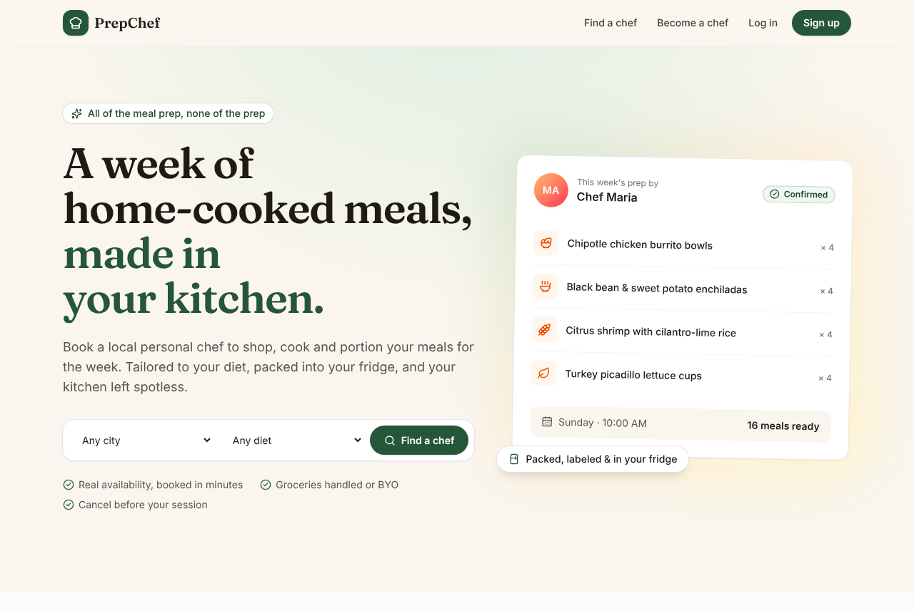
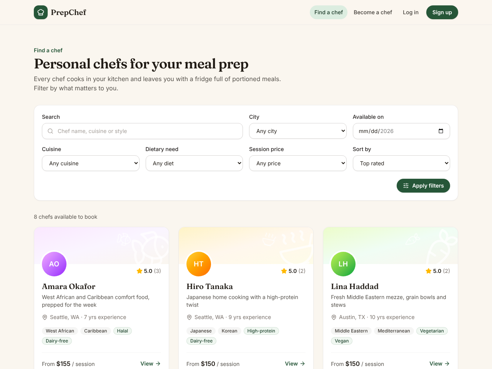
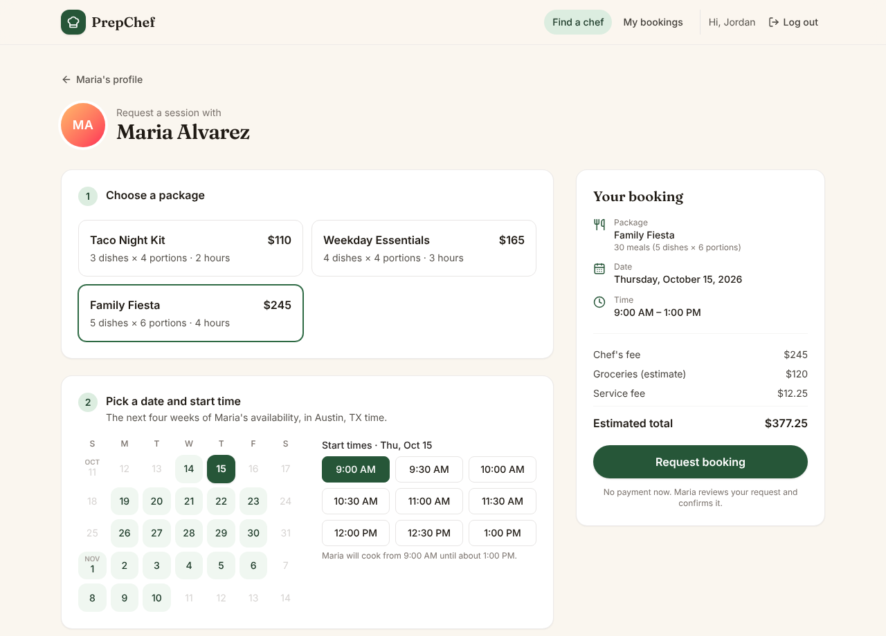
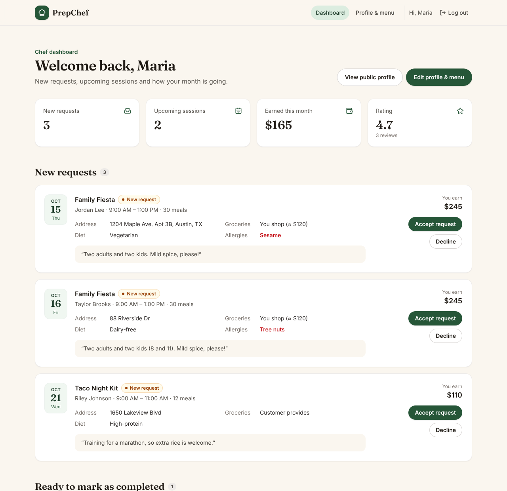
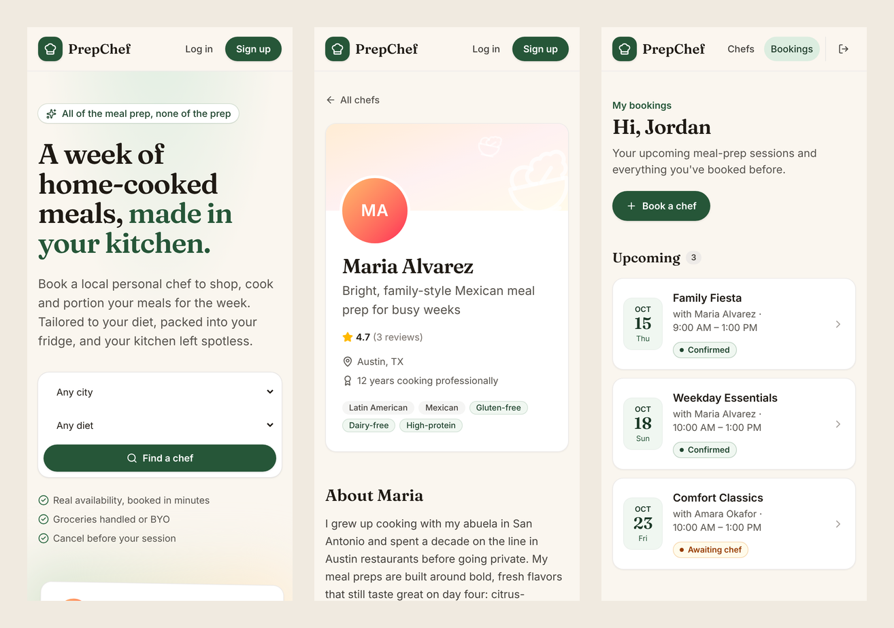

# PrepChef

Book a personal chef to cook your week of meal prep, in your own kitchen.

PrepChef is a two-sided marketplace. Customers browse local chefs, pick a meal-prep package and an open time, and send a booking request. Chefs manage their profile, menu and weekly hours, then accept, decline and complete sessions.



## Features

**For customers**

- Browse chefs and filter by city, cuisine, dietary need, price and the date you need them.
- Chef profiles with a bio, packages (dishes × portions, session length, price per meal), weekly hours and reviews.
- Book in four steps: choose a package, pick a date and an open start time, add the kitchen address and who buys groceries, then list dietary needs and allergies. The price summary updates as you go.
- Follow each booking from request to confirmed to completed, cancel before the session starts, and review completed sessions.

**For chefs**

- A dashboard with new requests, sessions to mark as completed, upcoming sessions, this month's earnings and your rating.
- Accept, decline, cancel or complete sessions.
- Edit your profile, weekly hours and packages. Customers see changes right away.
- New chefs get a setup checklist, and only appear in search once they have hours and at least one package.

| Browse chefs | Book a session |
| --- | --- |
|  |  |

| Chef dashboard | On a phone |
| --- | --- |
|  |  |

## Getting started

You need Node.js 22.12 or newer.

```bash
npm install
npm run dev
```

Open http://localhost:3000. The first request creates `data/prepchef.db` and fills it with demo chefs, customers and bookings dated around today.

### Demo accounts

Every demo account uses the password `password123`. The login page has buttons that fill them in.

| Role | Email | Things to try |
| --- | --- | --- |
| Customer | `demo@prepchef.test` | Book a chef, cancel a pending request, review a past session |
| Chef | `maria@prepchef.test` | Accept or decline requests, mark a session completed, edit the menu and hours |

To start over with fresh demo data, stop the server and run `npm run db:reset`.

## Scripts

| Command | What it does |
| --- | --- |
| `npm run dev` | Start the development server |
| `npm run build`, then `npm start` | Build and run the production server |
| `npm test` | Run the unit and integration tests (Vitest) |
| `npm run lint` | Lint with ESLint |
| `npm run typecheck` | Type-check, including Next.js route types |
| `npm run db:reset` | Delete the local database |

## Configuration

Everything is optional. See `.env.example`.

| Variable | Default | Purpose |
| --- | --- | --- |
| `DATABASE_PATH` | `./data/prepchef.db` | Where the SQLite database lives |
| `SEED_DEMO_DATA` | `true` | Seed demo data into an empty database and show the demo logins |
| `SESSION_COOKIE_SECURE` | `true` in production | Set to `false` only when serving a production build over plain HTTP |
| `TZ` | The server's timezone | Booking dates and times are wall-clock times in this timezone |

## How booking works

- **Availability.** Each chef sets one working window per weekday. Customers can book from tomorrow up to four weeks ahead, with start times every 30 minutes, and the whole session has to fit inside the window.
- **No double booking.** Pending and confirmed bookings block the chef's calendar, with a 60-minute buffer between sessions for travel and cleanup. When a request is saved, the slot is checked again inside a SQLite `BEGIN IMMEDIATE` transaction, so two customers can never get the same time.
- **Statuses.** A request starts as *pending*, and the chef accepts it (*confirmed*) or declines it. Customers can cancel pending or confirmed bookings before they start, and chefs can cancel confirmed ones. The chef marks a session *completed* once it has started. Requests nobody answered expire at their start time.
- **Pricing.** The chef's fee (the package price), plus the chef's grocery estimate if they do the shopping, plus a 5% service fee. Prices are copied onto the booking, so later menu changes don't affect existing bookings.
- **Reviews.** Only the customer on a completed session can review it, and only once.

These rules live in `src/lib/` and are covered by the tests in `tests/`.

## Project structure

```
src/
  app/            Pages (Next.js App Router)
  actions/        Server actions for accounts, bookings and chef profiles
  components/     UI components
  lib/            Business logic and data access
    availability.ts   Open start times from working hours and existing bookings
    bookings.ts       Booking requests, status changes and reviews
    chefs.ts          Search, profiles, hours and packages
    pricing.ts        Quotes and price per meal
    schema.ts         SQLite schema migrations
    seed.ts           Demo data
tests/            Vitest tests
```

## Tech stack

Next.js 16 (App Router and Server Actions), React 19, TypeScript, Tailwind CSS 4, SQLite through better-sqlite3, and Vitest.

Passwords are hashed with scrypt, and sessions use HTTP-only cookies. The database stores only a hash of each session token.

## What's next

Ideas for taking this beyond an MVP:

- Payments, for example with Stripe: authorize when the chef accepts and charge after the session.
- Email or SMS notifications for new requests and status changes.
- Messaging between customers and chefs, and recurring weekly bookings.
- Chef onboarding checks (ID, food-safety certification, insurance) and service areas.
- Postgres and rate limiting on login before running more than one server instance in production.
